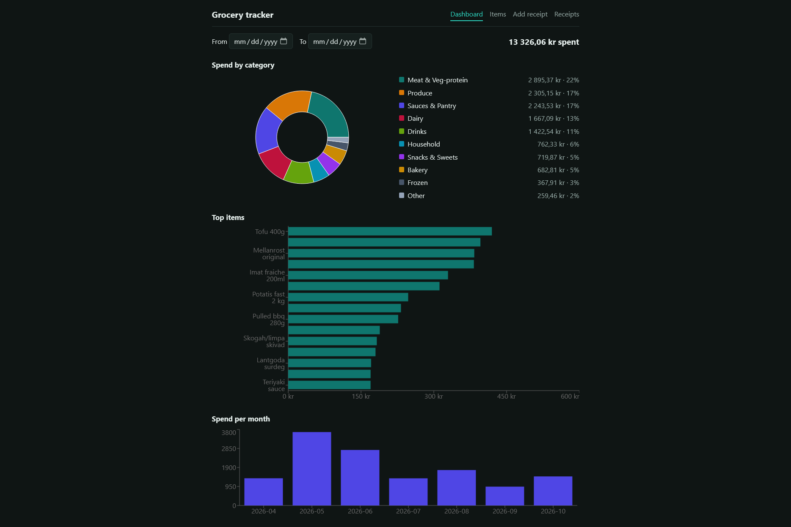
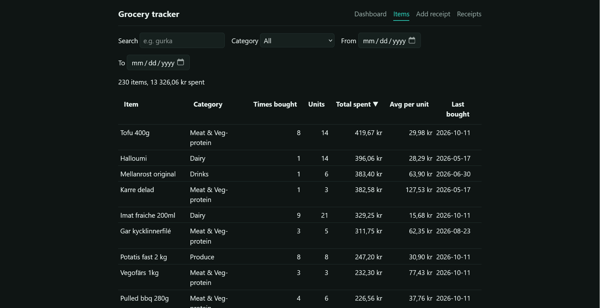
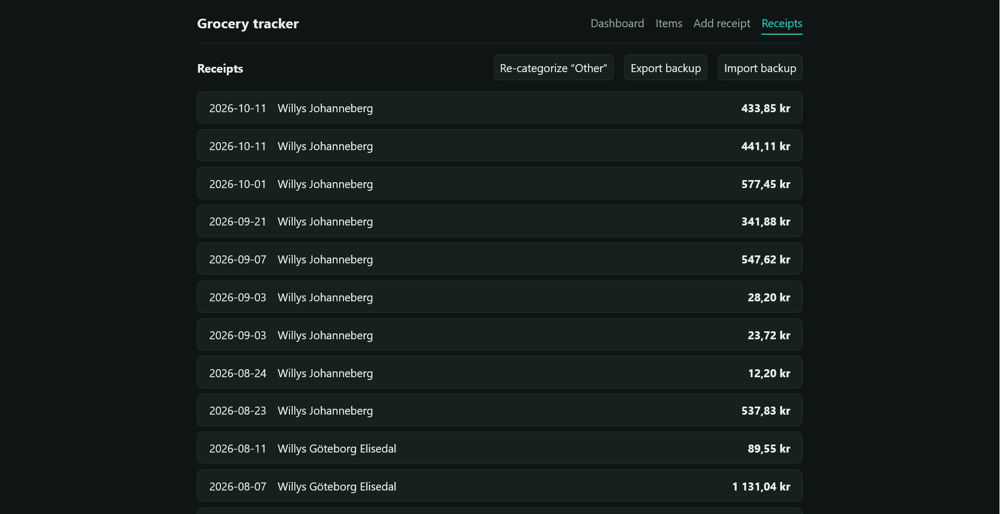
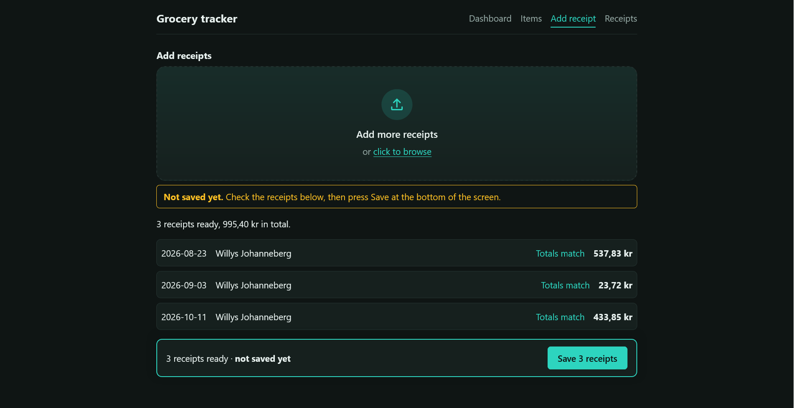

# grocery-tracker

A web app that shows which groceries you spend the most on, based on your Willys self-scan receipts.

Everything runs in your browser. Data is stored locally in IndexedDB. No server, no AI, no network calls.

[![Last Commit][last-commit-shield]][last-commit-url]
[![Repo Size][repo-size-shield]][repo-size-url]
[![Author][author-shield]][author-url]



## Index

1. [Features](#features)
1. [Screenshots](#screenshots)
1. [Built with](#built-with)
1. [Getting started](#getting-started)
1. [Scripts](#scripts)
1. [Project structure](#project-structure)
1. [Backups](#backups)
1. [Contributing](#contributing)
1. [Author](#author)

## Features

- Upload Willys self-scan receipt PDFs and have them parsed automatically
- Sanity check: the parsed item sum and item count are compared against the receipt totals
- Automatic categorization of items using editable keyword lists
- Review screen where you can correct categories; your corrections are remembered and take priority over keywords next time
- Overview of which groceries and categories you spend the most on
- Fully local: data never leaves your browser
- Export a backup of your receipts

## Screenshots
 
| Dashboard | Items |
|---|---|
|  |  |
 
| Receipts | Add receipt |
|---|---|
|  |  |
 


## Built with

![React][tech-react-shield]
![Vite][tech-vite-shield]
![TypeScript][tech-ts-shield]
![IndexedDB][tech-idb-shield]

## Getting started

### Prerequisites

- Node.js 20+ and npm

### Installation

```sh
# Clone the repository
git clone https://github.com/erikpersson0884/grocery-tracker.git

# Go into the project directory
cd grocery-tracker

# Install dependencies
npm install

# Start the dev server
npm run dev
```

Open the localhost URL printed in the terminal.

## Scripts

| Command | What it does |
|---|---|
| `npm run dev` | Start the dev server |
| `npm run build` | Build for production |

## Project structure

- `src/parsing/willys.ts`: receipt parser (regex). Checks the item sum and count against the receipt totals.
- `src/categorize.ts`: keyword lists for automatic categories. Edit these to improve categorization.

## Backups

Data is stored in your browser's IndexedDB, so clearing browser data deletes it.
Use **Export backup** on the Receipts page now and then.

## Contributing

1. Fork the repository
2. Create a new branch (`git checkout -b feature-branch`)
3. Make your changes
4. Commit your changes (`git commit -m 'Add new feature'`)
5. Push to the branch (`git push origin feature-branch`)
6. Open a Pull Request

## Author

- [Erik Persson](https://github.com/erikpersson0884) 🐦

<!-- Repo info shields -->
[last-commit-shield]: https://img.shields.io/github/last-commit/erikpersson0884/grocery-tracker/main?style=for-the-badge&cacheSeconds=30
[last-commit-url]: https://github.com/erikpersson0884/grocery-tracker/commits/main

[repo-size-shield]: https://img.shields.io/github/repo-size/erikpersson0884/grocery-tracker?style=for-the-badge&cacheSeconds=60
[repo-size-url]: https://github.com/erikpersson0884/grocery-tracker

[author-shield]: https://img.shields.io/badge/Author-Erik%20Persson-blue?style=for-the-badge
[author-url]: https://github.com/erikpersson0884

<!-- Tech stack shields -->
[tech-ts-shield]: https://img.shields.io/badge/TypeScript-3178C6?logo=typescript&logoColor=white&style=for-the-badge
[tech-idb-shield]: https://img.shields.io/badge/IndexedDB-4B5563?style=for-the-badge

[tech-react-shield]: https://img.shields.io/badge/React-61DAFB?logo=react&logoColor=black&style=for-the-badge
[tech-vite-shield]: https://camo.githubusercontent.com/ac6cc80b07183964a418673d95d35fc73116d6caae66dc9a9a7894540053e2fc/68747470733a2f2f696d672e736869656c64732e696f2f62616467652f566974652d3634364346463f6c6f676f3d56697465266c6f676f436f6c6f723d7768697465267374796c653d666f722d7468652d6261646765

